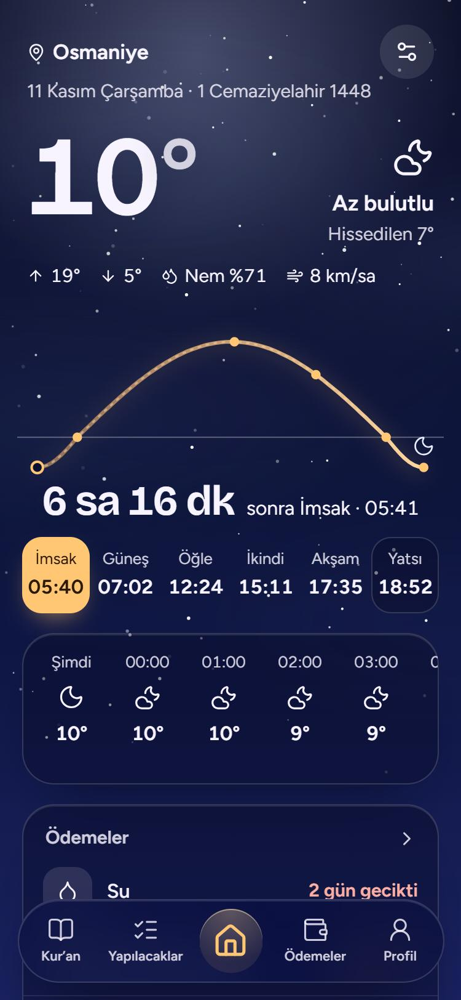
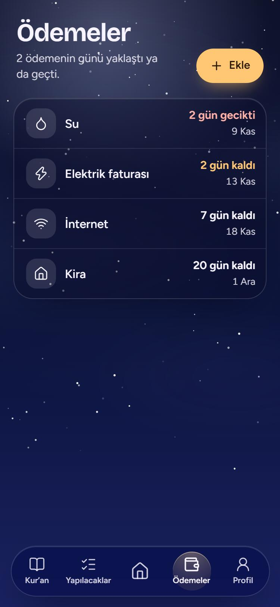
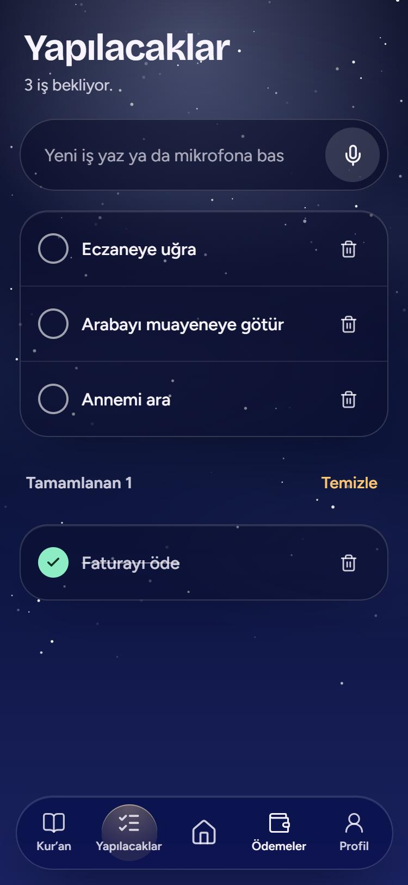
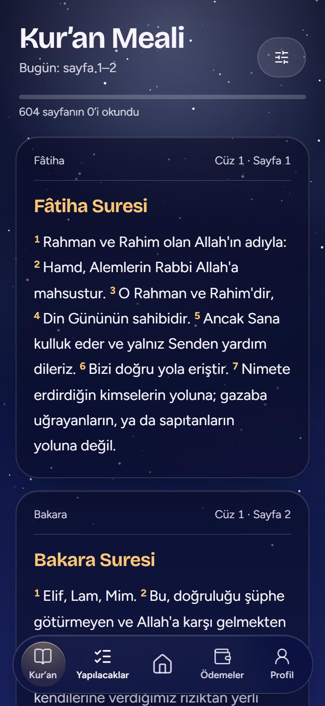
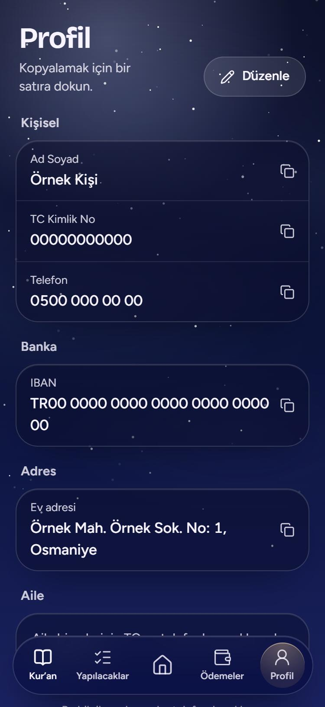

# Günüm

**Kendim İçin Yaptığım Mobil Hobi Projesidir.**

Günlük hayatımı kolaylaştırmak için kendi telefonuma kurduğum küçük bir Android uygulaması. Mağazada yayınlanmaz, hesap ya da sunucu gerektirmez; bütün veriler yalnızca telefonda tutulur.

<p>
  
  
  
</p>
<p>
  
  
  
</p>

## Neler var

Altta beş sekme var, ana sayfa ortada. Sayfalar arasında sağa sola kaydırarak geçiliyor.

- **Ana sayfa:** seçili konumun (varsayılan Osmaniye Merkez) hava durumu, saatlik ve 7 günlük tahmin; güneşin gün içindeki yolu üzerinde namaz vakitleri ve sıradaki vakte kalan süre; yaklaşan ödemeler ile bekleyen işler.
- **Canlı arka plan:** gökyüzü günün vaktine göre değişir (imsak, gün doğumu, öğle, gün batımı, gece) ve havaya göre bulut, yağmur ya da kar çizilir.
- **Ödemeler:** listede yalnızca ad ve son ödeme tarihine kalan gün görünür. Abone bilgileri ayrıntıda durur, dokununca kopyalanır. "Ödendi" denince aylık ödeme bir sonraki aya geçer.
- **Yapılacaklar:** yazarak ya da mikrofona basıp söyleyerek iş eklenir.
- **Kur'an Meali:** günde iki sayfa; okunmayan gün aynı sayfalarda kalınır. Birkaç meal arasından seçilebilir, bir kez inen sayfa internetsiz de açılır.
- **Profil:** adres, IBAN, telefon, kimlik ve aile bilgileri gibi sık gereken bilgiler; dokununca panoya kopyalanır.
- **Bildirimler:** namaz vakitleri ve yaklaşan ödemeler için yerel bildirimler.
- **Yedek:** veriler panoya kopyalanıp geri yüklenebilir.

## Teknik notlar

- React, TypeScript, Vite; telefon uygulaması için Capacitor.
- Animasyonlar [Motion](https://motion.dev) ile.
- Namaz vakitleri [adhan](https://github.com/batoulapps/adhan-js) ile telefonda hesaplanır (Diyanet yöntemi); resmi takvimden 1-2 dakika sapabilir.
- Hava durumu: [Open-Meteo](https://open-meteo.com). Meal metinleri: [alquran.cloud](https://alquran.cloud).
- Bütün kayıtlar `localStorage` içinde durur; uygulama silinirse gider.

## Derleme

Gerekenler: Node.js 20+, JDK 21 ve Android SDK.

```bash
npm install
npm run dev          # tarayıcıda önizleme
npm run sync         # web paketini derleyip Android projesine aktarır
cd android
./gradlew assembleDebug
```

APK `android/app/build/outputs/apk/debug/` altında oluşur.
